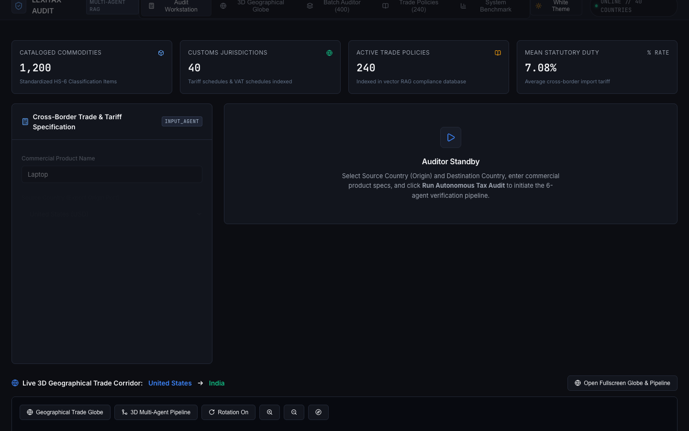
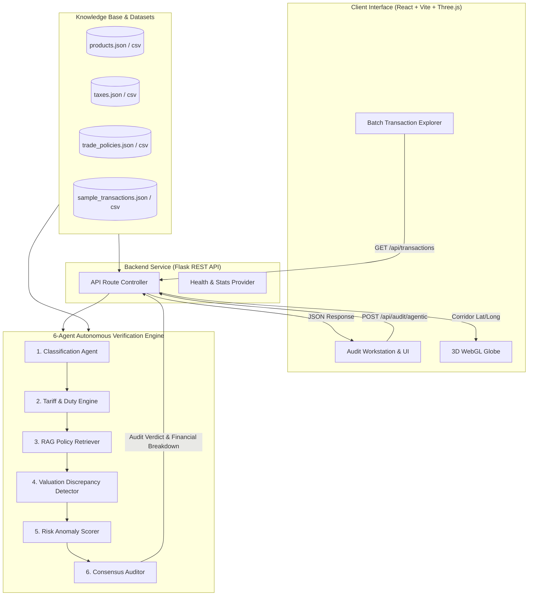

# 🛡️ LEXITAX AUDIT — Autonomous Multi-Agent AI Tax & Customs Auditor

[](LICENSE)
[](https://www.python.org/)
[](https://reactjs.org/)
[](https://vitejs.dev/)
[](https://threejs.org/)
[](https://flask.palletsprojects.com/)

> **An enterprise-grade, multi-agent Retrieval-Augmented Generation (RAG) system for autonomous cross-border customs auditing, international trade policy compliance, and tariff discrepancy detection.**

---

## 📸 Visual Showcase

### 1. Interactive 3D Geographical Trade Corridor & Navigation

*Interactive Three.js 3D global visualization showing real-time trade corridors, orbital cargo routes, and dynamic continent projection.*

### 2. Autonomous Audit Workstation & Discrepancy Detection

*Live Audit Workstation featuring statutory tariff comparison, HS classification validation, under-reporting detection, and multi-agent compliance verdicts.*

---

## 📌 Overview & Problem Statement

Cross-border trade and customs auditing face severe modern challenges:
1. **Exponential Trade Volume**: Millions of global shipments occur daily, making manual invoice inspections statistically impossible.
2. **Harmonized System (HS) Misclassification**: Goods are frequently misclassified under lower-tariff HS codes to evade duties.
3. **Valuation Under-Reporting**: Fraudulent transfer pricing and invoice undervaluation cause trillions in lost national revenue.
4. **Dynamic Trade Policies & Tariffs**: Trade sanctions, preferential trade agreements (PTAs), and retaliatory duties evolve constantly across 200+ jurisdictions.

**LEXITAX AUDIT** resolves these bottlenecks by combining a **6-Agent Autonomous Audit Pipeline** with a **TF-IDF Semantic RAG Engine**, processing multi-thousand trade transactions, cataloging 1,200+ commodities across 40 customs jurisdictions, and benchmarking declared values against statutory policies in sub-second latency.

---

## 🌟 Key Features

- 🤖 **6-Agent Autonomous Audit Pipeline**:
  - **Classification Agent**: Evaluates product descriptions, category match scores, and validates 6-digit Harmonized System (HS-6) codes.
  - **Tariff & Tax Engine**: Computes exact statutory customs duty, national VAT/GST, and assessable freight values.
  - **RAG Policy Retriever**: Semantic TF-IDF search over 240+ international trade policies, checking export controls, quotas, and bilateral treaties.
  - **Valuation & Discrepancy Detector**: Detects fraudulent undervaluation by calculating deviation against historical commodity benchmarks.
  - **Risk & Anomaly Scorer**: Computes composite risk percentiles based on trade routes, value anomalies, and policy restrictions.
  - **Consensus & Reconciliation Auditor**: Synthesizes agent evaluations into an authoritative compliance verdict (`COMPLIANT`, `FLAGGED`, `WARNING`).
- 🌐 **Interactive 3D WebGL Trade Globe**:
  - GPU-accelerated globe powered by **Three.js**, visualizing source origin, destination ports, and real-time cargo flight arcs.
- 📦 **Batch Transaction Auditor**:
  - Filterable, searchable interface processing high-volume commercial transaction logs with instant anomaly flags.
- 📜 **Trade Policies & Tariff Database**:
  - Full catalog of 240+ international trade policies across 40 countries with instant compliance notes and category indexing.
- ⚡ **Dual Engine Benchmarking**:
  - Side-by-side performance comparison between **Autonomous Multi-Agent RAG** vs **Traditional Single-Pass Rule Auditor**.
- 🎨 **Dynamic Dark & Light Mode UI**:
  - High-performance responsive interface built with React 18, GSAP smooth entrance animations, and Lucide icons.

---

## 🏛️ System Architecture



---

## 📊 Dataset Catalog

| Dataset File | Records | Description |
| :--- | :---: | :--- |
| `products.csv` / `.json` | **1,200** | Standardized commodities with HS-6 classification, benchmark unit prices, and category taxonomy. |
| `taxes.csv` / `.json` | **40** | Sovereign customs jurisdictions, statutory import duty percentages, and standard VAT/GST schedules. |
| `trade_policies.csv` / `.json` | **240** | Multilateral treaties, preferential agreements, quota restrictions, and regulatory compliance guidelines. |
| `sample_transactions.csv` / `.json` | **400** | Commercial shipment invoices with declared values, importer details, and empirical audit status. |

---

## 🚀 Getting Started

### Prerequisites
- **Python**: 3.10 or higher
- **Node.js**: 18.0 or higher
- **npm**: 9.0 or higher

---

### 1. Clone the Repository

```bash
git clone https://github.com/K-Siddharth-Reddy-CR7/AI-Tax-Auditor.git
cd AI-Tax-Auditor
```

---

### 2. Backend Setup (Flask API)

1. Open a terminal and navigate to the project root:
```bash
python3 -m venv venv
source venv/bin/activate  # On Windows: venv\Scripts\activate
pip install -r backend/requirements.txt
```

2. Start the backend server:
```bash
python3 backend/server.py
```
*The backend server starts on `http://localhost:5001`.*

Verify backend health:
```bash
curl http://localhost:5001/api/health
```

---

### 3. Frontend Setup (React + Vite)

1. Open a second terminal and navigate to `frontend`:
```bash
cd frontend
npm install
```

2. Launch the Vite development server:
```bash
npm run dev
```
*The application will be live at `http://localhost:5173`.*

---

## 🔌 API Reference

| Endpoint | Method | Description |
| :--- | :---: | :--- |
| `/api/health` | `GET` | Returns backend service status and dataset counts. |
| `/api/stats` | `GET` | Returns aggregate statistics (countries, commodities, average tariff rates). |
| `/api/countries` | `GET` | Returns all 40 indexed customs jurisdictions and tax schedules. |
| `/api/products` | `GET` | Returns cataloged commodities with pagination and keyword filtering. |
| `/api/policies` | `GET` | Returns compliance policies with optional country/category filters. |
| `/api/transactions` | `GET` | Returns sample transactions with pagination and risk filtering. |
| `/api/audit/agentic` | `POST` | Executes the full 6-agent autonomous audit on a commercial transaction. |
| `/api/audit/normal` | `POST` | Executes baseline single-pass rule audit for comparison. |
| `/api/audit/compare` | `POST` | Runs both agentic and standard audits side-by-side to benchmark accuracy. |

#### Sample Request Body (`/api/audit/agentic`):
```json
{
  "product_name": "Laptop",
  "source_country": "United States",
  "destination": "India",
  "declared_value": 850.0,
  "declared_duty": 50.0,
  "declared_vat": 120.0
}
```

---

## 📁 Repository Structure

```
├── Datasets/                     # Raw dataset directory
├── backend/
│   ├── requirements.txt          # Python dependencies (Flask, Flask-CORS)
│   └── server.py                 # Multi-Agent RAG Engine & REST API
├── frontend/
│   ├── index.html                # Application root HTML
│   ├── package.json              # NPM dependencies & scripts
│   ├── vite.config.js            # Vite bundler configuration
│   └── src/
│       ├── App.jsx               # Audit Workstation & navigation shell
│       ├── api.js                # Axios / Fetch client layer
│       ├── index.css             # Design system tokens & utility styles
│       ├── main.jsx              # React DOM mounting & React Router setup
│       ├── components/
│       │   ├── AuditConsole.jsx  # Single transaction audit workstation
│       │   ├── BatchAuditor.jsx  # 400-transaction batch analyzer
│       │   ├── PolicyExplorer.jsx# Trade policy & tariff browser
│       │   ├── SystemBenchmark.jsx# Multi-agent vs standard auditor benchmark
│       │   └── ThreeCanvas.jsx   # Three.js 3D geographical trade corridor
│       └── pages/
│           └── HomePage.jsx      # High-impact landing page & 3D hero
├── screenshots/                  # High-resolution application screenshots
│   ├── 01_interactive_3d_globe.png
│   └── 02_audit_workstation_dashboard.png
├── load_tax_auditor_datasets.py  # Dataset validation & loading utility
├── Majorpro (1).ipynb            # Research notebook, model exploration & EDA
├── products.csv / .json          # Commodity database (1,200 items)
├── taxes.csv / .json             # Sovereign tax rate schedules (40 countries)
├── trade_policies.csv / .json    # Trade compliance treaties (240 policies)
├── sample_transactions.csv / .json# Commercial transactions (400 records)
├── .gitignore                    # Git ignore file
└── README.md                     # Comprehensive project documentation
```

---

## 🧪 Research & Exploratory Data Analysis

The repository includes [`Majorpro (1).ipynb`](Majorpro%20(1).ipynb), containing:
- Exploratory data analysis (EDA) of global customs rates and duty variances.
- Anomaly distribution modeling on transactional values.
- Prototype classification validation on Harmonized System codes.

---

## 👤 Author

**K. Siddharth Reddy**
- GitHub: [@K-Siddharth-Reddy-CR7](https://github.com/K-Siddharth-Reddy-CR7)

---

## 📄 License

This project is licensed under the [MIT License](LICENSE) — feel free to use, modify, and distribute for academic and professional purposes.
